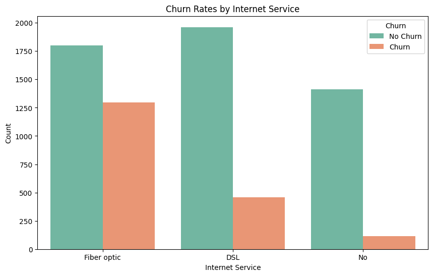
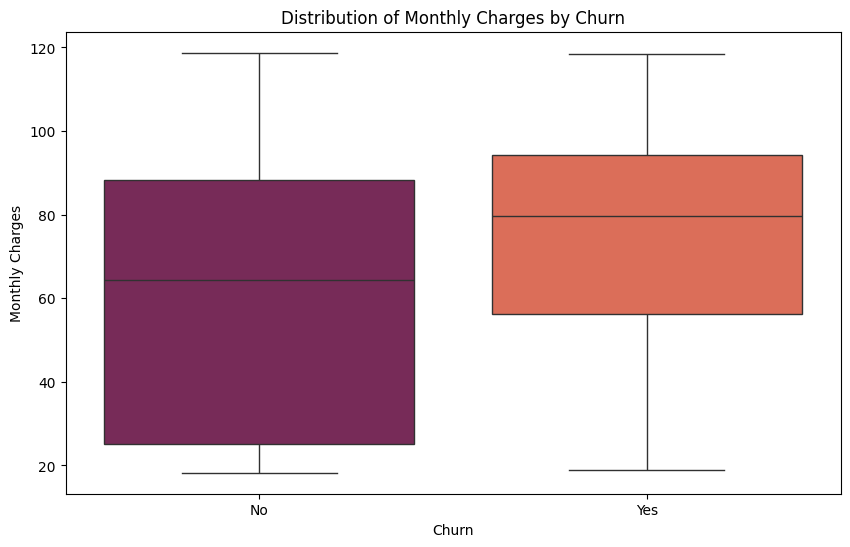
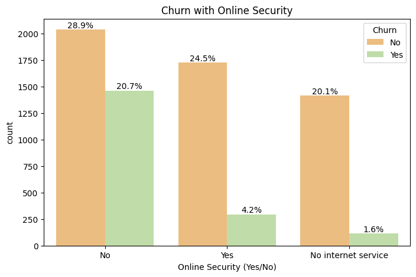
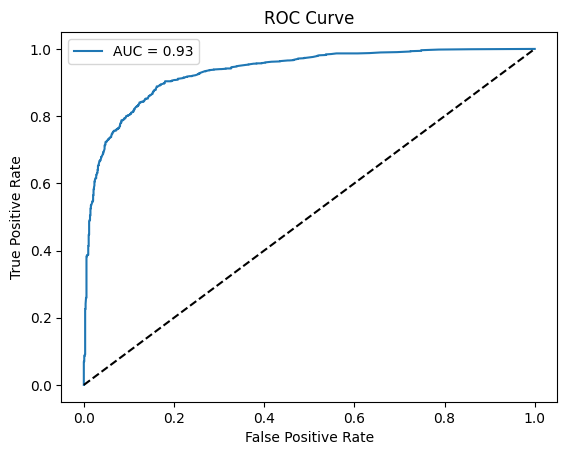

# Customer Churn Prediction Web Application

## Overview
This project is a full-stack web application designed to predict customer churn using a machine learning model. The application helps businesses identify customers who are likely to churn, allowing for targeted interventions. The project involves data preprocessing, exploratory data analysis (EDA), model building, and deployment.

**Project Duration:** February 2024 - May 2024

## Features
- **Backend**: Developed using Python and Flask, featuring RESTful APIs for data handling and model predictions.
- **Machine Learning Model**: Implemented a Random Forest Classifier achieving an accuracy of 87%.
- **Exploratory Data Analysis (EDA)**: Conducted EDA to identify key factors influencing customer churn.
- **Frontend**: Designed a responsive user interface using HTML, CSS, and JavaScript.
- **Deployment**: Hosted on Render for public access.

## Tech Stack
- **Backend**: Python, Flask
- **Frontend**: HTML, CSS, JavaScript
- **Machine Learning**: Scikit-learn, Pandas
- **Visualization**: Matplotlib, Seaborn
- **Deployment**: Render

## Setup and Installation

1. **Clone the repository:**
   ```bash
   git clone https://github.com/your-username/customer-churn-prediction.git
   cd customer-churn-prediction
2. **Install: dependencies:**
   ```bash
   pip install -r requirements.txt
3. **Run the Flask application:**
   ```bash
   python app.py
4. **Access the application:**
   Open your browser and navigate to http://localhost:5000.
## Exploratory Data Analysis (EDA)
Key insights from the EDA include the impact of internet service, monthly charges, and security features on customer churn. Below are some visualizations:
### 1. Churn by Internet Service


### 2. Churn by Monthly Charges


### 3. Churn with Online Security

## Model Performance 
The Random Forest Classifier was used for prediction, and the model's performance is summarized by the ROC curve below:
### ROC Curve

## Deployment
The application is deployed and publicly accessible at the following link: [Customer Churn Prediction Application](https://customer-churn-51ou.onrender.com/)
## How to use
1. Enter customer details in the provided form on the homepage.
2. Click the "Predict" button to get a prediction on whether the customer is likely to churn.
3. View the prediction result and consider interventions for customers predicted to churn.
## Contact
For any inquiries or feedback, feel free to reach out via Alirajhabib@gmail.com


I'm preparing for a job interview for an entry-level Software Engineer role focused on PRODUCTION ENGINEERING: troubleshooting production issues, applying patches and security updates, improving monitoring, stability, scalability, automated tests, and documentation. I need concrete, evidence-backed stories about MY work (author: Raj Habib / raj.habib@usaa.com / PL6Z172) from Nov 2025 to now.

Use the Git history AND the GitLab MCP (merge request descriptions, review comments/discussions, linked issues/Jira keys, pipeline results) across these repos: dynamic-api, model batch, tns-fastapi, analyzer package.

RULES
- Only credit me where I'm the commit AUTHOR or the MR author. If I was only the committer, reviewer, or the core logic was someone else's, label it "team/other" separately.
- Label every number as VERIFIED (from pipeline/logs/MR data), CLAIMED (changelog/MR text with no measurement), or UNKNOWN. Never invent numbers.
- Do NOT include secrets, credentials, internal hostnames, connection strings, or any member/customer data. Paraphrase anything sensitive.
- Keep each story under ~250 words. Use markdown.

PART 1 — DEEP DIVE ON THESE STORIES
For each, give: (1) Situation/problem: what broke or what was needed, how it was noticed (alert, user report, logs, failing pipeline), and who was affected; (2) Root cause and how it was diagnosed; (3) Options considered/tried, including ones abandoned and why; (4) What I specifically built or changed (files, services, key design decisions); (5) How it was tested/verified (tests added, pipeline results, manual checks); (6) Result/impact with any numbers and their labels; (7) Review feedback or discussion in the MR worth mentioning; (8) MR/commit/issue references.

  A. Multi-pod 404s / shared job state: session affinity -> Redis experiment -> Hazelcast job storage (dynamic-api, around MR !6, !9; commits 6ce22db, 46d264f; job_storage.py, helm/values.yaml).
  B. Memory reduction via chunked sentiment processing (model batch MR !41; changelog claims ~10 GB -> 2-3 GB, so find any evidence for or against).
  C. CVE / base-image / hardened-image remediation (tns-fastapi !17, !42-!47, !49; model batch !46-!48, !52; dynamic-api vulnerability work). What CVEs or scanner findings triggered it, how fixes were rolled out and verified.
  D. Direct Snowflake DL3 persistence replacing the MFP-transfer path (dynamic-api MR !29, commit f0a1f4f, merge 1e0f037). Why the old path was a problem.
  E. Combined use case reusing component sentiment/emotion instead of rerunning Gemini, with readiness gating (model batch !42-!43). Cost/time impact.
  F. LLM reliability: topic-summary validation, correction retries, fallback (model batch !25); async generation with semaphore concurrency and rate-limit retries (analyzer api-delay; changelog claims 5-10x speedup for 40+ topics); embedding retry/backoff (analyzer resource-fix).
  G. BERTopic packaging under offline/dependency constraints with a vendored wheel and Docker/CI changes (dynamic-api !24, model batch !40).
  H. Structured JSON logging for Kibana (model batch !49-!50). What visibility problem it solved.

PART 2 — FIND ADDITIONAL STORY MATERIAL
Search my MRs, commits, issues, and pipeline history for:
  1. Production incidents, hotfixes, or urgent fixes I made (look for words like fix, hotfix, revert, error, timeout, 404, 500, OOM, failed, incident, rollback). Include the "Slack extractor job error" if it involves me.
  2. A MISTAKE or revert of mine and what I learned (e.g. commit acc185b "Requirements revert", Oct 8). What went wrong and how it was caught.
  3. Pipeline/CI failures I diagnosed and fixed (Helm, GitLab CI, Conjur, certificates).
  4. Bugs I fixed in SQL or data correctness (e.g. tns-fastapi !33 quote escaping, timeout/SQL fixes in dynamic-api !9-!12, source-mapping !38/!52).
  5. Monitoring/observability or alerting improvements.
  6. Testing work I did: tests I added, coverage changes, test frameworks used.
  7. Documentation I wrote (READMEs, runbooks, changelogs, MR descriptions).
  8. Collaboration evidence: reviews I gave, cross-team work, onboarding a new business case with stakeholders, meaningful review discussions.
Rank the top 5 additional items by how well they show production-engineering skills.

PART 3 — SUMMARY
  - A table: Story | Skill it demonstrates (troubleshooting / patching & security / stability & scalability / testing / monitoring / documentation / collaboration) | Strength (high/med/low) | Missing info I should fill in from memory.
  - Full list of technologies I've personally used, grouped by: languages, frameworks/APIs, data stores, messaging, cloud, containers/orchestration, CI/CD, observability, testing, ML/LLM.
  - My first and last authored commit dates and approximate counts of authored commits and authored MRs per repo (VERIFIED only).
